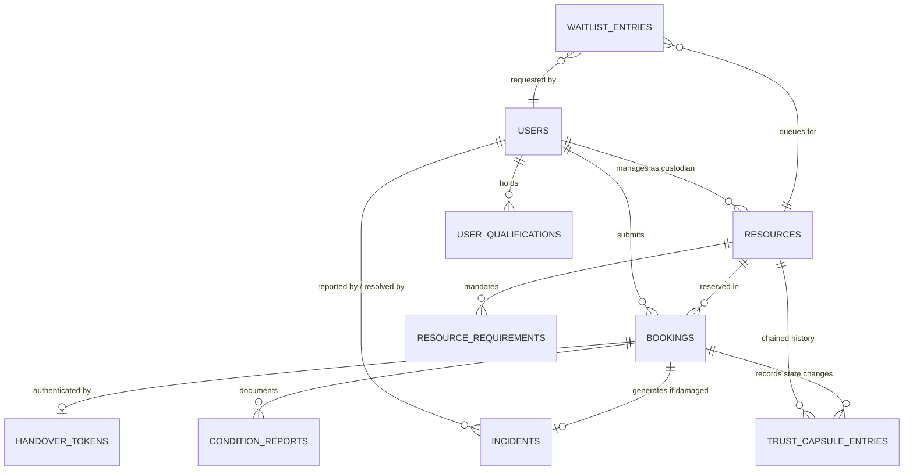

# PACT: Technical Architecture & System Design

> **Full Form**: Proof, Authorization, Custody & Trust  
> **Repository**: https://github.com/EnternalBlue07/Pact_Resources  
> **Status**: Living Architectural Specification (CodeHack India 2026)

---

## 1. System Overview & Component Topography

PACT implements a decoupled, modern client-server architecture designed for high velocity, clean separation of concerns, and verifiable data integrity.

```
+---------------------------------------------------------------------------------------+
|                                    CLIENT TIER                                        |
|  React 18+ (Vite) + TypeScript + Tailwind CSS                                         |
|                                                                                       |
|  [Catalog & Search]    [Custodian Console]    [Admin Suite]    [Trust Replay & Arena]  |
+-------------------------------------------+-------------------------------------------+
                                            |
                                            | HTTPS / JSON REST API
                                            v
+---------------------------------------------------------------------------------------+
|                                 FASTAPI SERVICE TIER                                  |
|                                                                                       |
|  - CORS & Request Validation (Pydantic V2)                                            |
|  - Stateless JWT Bearer Authentication & RBAC Dependencies                            |
|  - Standardized JSON Error Handler Middleware                                         |
+-------------------------------------------+-------------------------------------------+
                                            |
                                            v
+---------------------------------------------------------------------------------------+
|                                  CORE SERVICES TIER                                   |
|                                                                                       |
|  +-----------------------+  +-----------------------+  +---------------------------+  |
|  | Resource Catalog Svc  |  | Zero-Trust Gate       |  | Booking State Engine      |  |
|  | (CRUD & Availability) |  | (Prerequisite Rules)  |  | (Concurrency Locks)       |  |
|  +-----------------------+  +-----------------------+  +---------------------------+  |
|  +-----------------------+  +-----------------------+  +---------------------------+  |
|  | Handover Service      |  | Return & Incident Svc |  | Trust Capsule Engine      |  |
|  | (15-min Dual-Ack)     |  | (Evidence & Dispute)  |  | (SHA-256 Hash Chaining)   |  |
|  +-----------------------+  +-----------------------+  +---------------------------+  |
+-------------------------------------------+-------------------------------------------+
                                            |
                                            v
+---------------------------------------------------------------------------------------+
|                              PERSISTENCE & STORAGE TIER                               |
|                                                                                       |
|  +-----------------------------------------+  +------------------------------------+  |
|  | Relational Database (SQLAlchemy 2.0)    |  | Local / Cloud Evidence Storage     |  |
|  | - PostgreSQL (Prod) / SQLite (Dev)      |  | - Pre-use Baseline Photographs     |  |
|  | - ACID Transactions & Row-Level Locks   |  | - Post-use Return Inspection Photos|  |
|  +-----------------------------------------+  +------------------------------------+  |
+---------------------------------------------------------------------------------------+
```

---

## 2. Tier Responsibilities & Boundaries

### 2.1. Frontend Tier (`frontend/`)
- **Framework**: React 18 / 19 with Vite, TypeScript (strict mode), and Tailwind CSS.
- **Responsibilities**:
  - Render catalog, availability calendars, and faceted category search filters.
  - Present plain-language eligibility feedback banners when prerequisites are missing.
  - Borrower handover modal (generating and displaying 15-minute countdown tokens).
  - Custodian inspection console (token verification, checklist sign-off, condition photo upload).
  - Administrator incident console (side-by-side pre/post-use photographic comparison).
  - Trust Replay timeline and interactive Security Arena diagnostic suite.
- **Boundaries**: Pure presentation and client-side form validation. **Zero business logic or authorization decisions are trusted from the frontend.**

### 2.2. Backend & API Gateway Tier (`backend/`)
- **Framework**: Python 3.12 with FastAPI, Uvicorn ASGI, and Pydantic V2.
- **Responsibilities**:
  - Authenticate institutional users and sign/verify stateless JWT bearer tokens.
  - Evaluate Zero-Trust qualification gate against real-time database records.
  - Enforce atomic booking state machine transitions ([FLOW.md](FLOW.md)).
  - Execute row-level database locks to eliminate double-booking race conditions.
  - Generate, hash, and verify single-use 15-minute handover tokens.
  - Calculate SHA-256 hash chains for the Trust Capsule audit ledger.
  - Return standardized, actionable JSON error responses.

### 2.3. Persistence Tier
- **Engine**: PostgreSQL 15+ in production (with local SQLite fallback for isolated testing).
- **ORM**: SQLAlchemy 2.0 with strict foreign key constraints and transactional rollback support.
- **Object Storage**: Local file system directory (`storage/evidence/`) for hackathon prototype; S3/GCS in cloud production.

---

## 3. Database Entity Schema & Relationships



---

## 4. Authentication, Authorization & Trust Boundaries

1. **Authentication**: Handled via signed JSON Web Tokens (HMAC-SHA256). Password hashes are computed with bcrypt/argon2. Demo credentials are pre-seeded with distinct institutional roles (`student@pact.local`, `custodian@pact.local`, `admin@pact.local`, `auditor@pact.local`).
2. **Authorization**: Enforced entirely server-side using FastAPI dependency injection (`Depends(require_role(...))`).
   - A `REQUESTER` cannot approve bookings, verify return checklists, or arbitrate incidents.
   - A `CUSTODIAN` cannot resolve incidents involving their own department without administrator review.
   - Users can **never** approve their own booking requests.

---

## 5. Booking State Management & Concurrency Control

To guarantee zero double-booking under concurrent load:
1. Every booking request runs within an isolated database transaction.
2. The query locks the resource row:
   ```sql
   SELECT id FROM bookings
   WHERE resource_id = :resource_id
     AND status IN ('APPROVED', 'HANDOVER_PENDING', 'CHECKED_OUT')
     AND NOT (end_time <= :new_start OR start_time >= :new_end)
   FOR UPDATE;
   ```
3. If an overlapping record exists, the transaction rolls back immediately and returns `HTTP 409 Conflict`.

---

## 6. Audit & Evidence Data Flow (Trust Capsule)

Every critical state transition triggers an audit event:
1. **Canonicalization**: The event payload is sorted alphabetically by key to produce deterministic JSON.
2. **Chaining**: The `prev_hash` is fetched from the resource's latest Trust Capsule block.
3. **Hashing**:
   $$\text{entry\_hash} = \text{SHA256}(\text{prev\_hash} + \text{canonical\_payload} + \text{timestamp} + \text{actor\_id})$$
4. **Persistence**: The block is saved atomically alongside the state change.
5. **Verification**: When an auditor requests `/api/v1/audit/verify-chain`, the server recalculates the chain from genesis. Any direct database row mutation breaks the chain and flags the corrupted block.

---

## 7. Standardized Error-Response Conventions

All API errors return a consistent, machine-parseable JSON format:

```json
{
  "error_code": "RESOURCE_SLOT_CONFLICT",
  "message": "The requested time window overlaps with an existing approved reservation.",
  "details": {
    "resource_id": "res-101",
    "conflicting_booking_id": "book-304",
    "waitlist_available": true
  },
  "timestamp": "2026-10-28T16:00:00Z"
}
```

---

## 8. Testing Boundaries & Strategy

- **Unit Tests**: State machine transition rules, token hashing, and SHA-256 block calculation.
- **Integration Tests**: FastAPI endpoint tests using `pytest` and `httpx` async test client.
- **Concurrency Tests**: Dispatches concurrent async requests to assert `409 Conflict` on race conditions.
- **Security Arena**: Live diagnostic endpoints executing simulated red-team attacks to verify server defense mechanisms.
