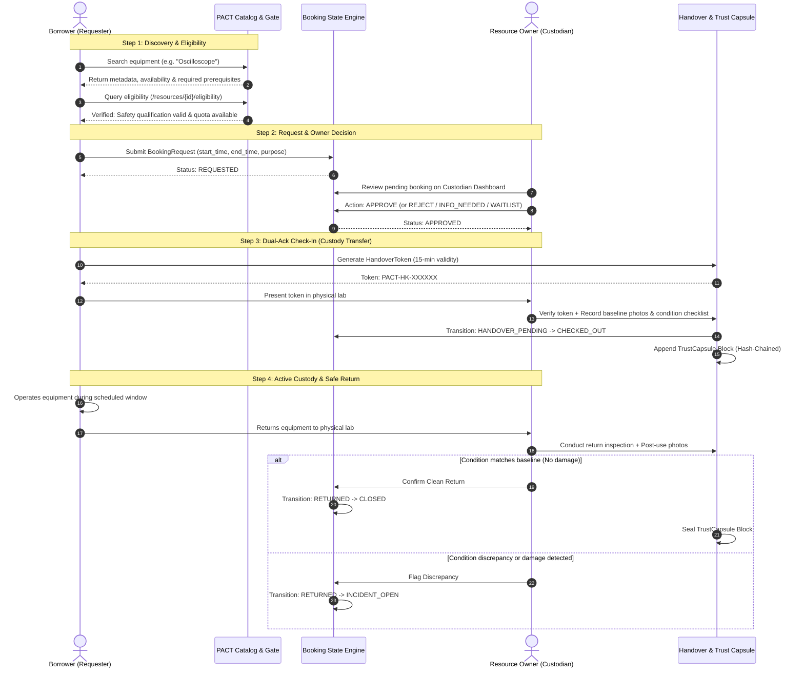
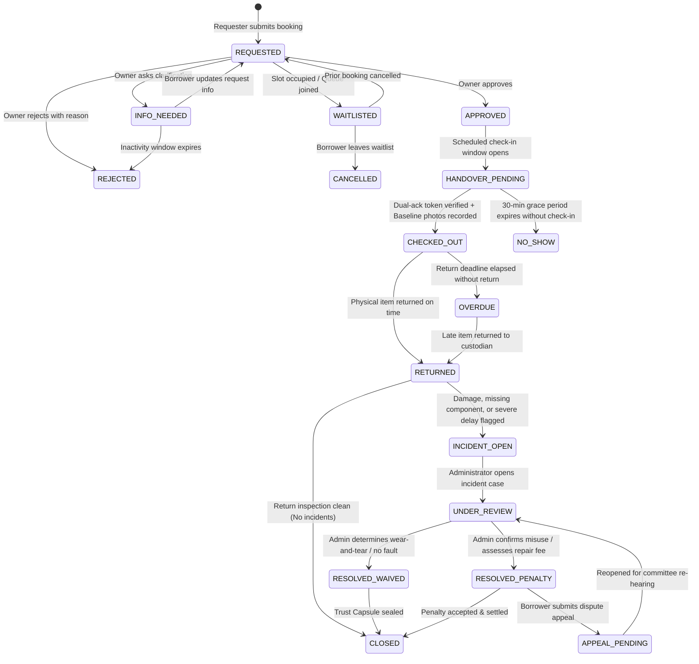

# PACT: Complete Operational Flow & State Transition Specification

> **Full Form**: Proof, Authorization, Custody & Trust  
> **Tagline**: *Proof Before Access. Evidence After Return.*  
> **Repository**: https://github.com/EnternalBlue07/Pact_Resources

---

## 1. Actors, Roles & Authority Boundaries

| Actor Role | Real-World Persona | Core Capabilities & Permissions | Security / Authority Boundaries |
| :--- | :--- | :--- | :--- |
| **`REQUESTER`** | Student, Researcher, Club Lead | Browse catalog, check eligibility, submit booking requests, generate handover token, upload return evidence, submit dispute appeal. | Cannot approve own requests. Cannot bypass prerequisite gates. Restricted to active concurrency quota (max 2). |
| **`CUSTODIAN`** | Lab Technician, Equipment Owner, Faculty | Register assets, define prerequisites, approve/reject/request info on bookings, verify check-in tokens, inspect returns, flag damage incidents. | Can only approve/inspect resources assigned to their custodial department. Cannot unilaterally modify historical audit logs. |
| **`ADMINISTRATOR`** | Department Head, Lab Director | Arbitrate flagged incidents, adjudicate appeals, assess penalties or waivers, manage user quotas, configure institutional policies. | Full operational oversight. Consequential actions (penalties/suspensions) require logged human rationale. |
| **`AUDITOR`** | Campus Inspector, Compliance Officer | Inspect Trust Replay timeline, verify cryptographic SHA-256 hash chains, export verifiable audit bundles. | Read-only access across all institutional resources and historical custody records. |

---

## 2. Resource-Sharing Lifecycle: Primary Happy Path



---

## 3. Comprehensive Booking State Machine



---

## 4. State Transition Authority & Invariants

| From State | To State | Trigger / Action | Authorized Role | Validation Rules & Preconditions |
| :--- | :--- | :--- | :--- | :--- |
| `[None]` | `REQUESTED` | `POST /bookings` | `REQUESTER` | User must pass eligibility rule; resource must have no overlapping `APPROVED` or `CHECKED_OUT` bookings; user active quota < 2. |
| `REQUESTED` | `APPROVED` | `POST /bookings/{id}/approve` | `CUSTODIAN` | Must be assigned custodian for this resource. Locks slot against overlapping requests. |
| `REQUESTED` | `REJECTED` | `POST /bookings/{id}/reject` | `CUSTODIAN` | Requires mandatory rejection justification text. |
| `REQUESTED` | `INFO_NEEDED`| `POST /bookings/{id}/request-info` | `CUSTODIAN` | Question posted to requester; requester notified. |
| `INFO_NEEDED`| `REQUESTED` | `POST /bookings/{id}/respond-info` | `REQUESTER` | Borrower updates justification or parameters. |
| `APPROVED` | `HANDOVER_PENDING` | System clock / Handshake init | System / `REQUESTER` | Starts within 15 minutes prior to scheduled start time. |
| `HANDOVER_PENDING` | `CHECKED_OUT` | `POST /handovers/verify` | `CUSTODIAN` | Handover token must match, be unexpired (<15 min), and marked `is_spent=True`. Pre-use baseline condition report mandatory. |
| `HANDOVER_PENDING` | `NO_SHOW` | Grace timer expiration | System scheduler | Triggered if token not verified 30 minutes after start time. Releases slot to waitlist. |
| `CHECKED_OUT` | `RETURNED` | `POST /returns/inspect` | `CUSTODIAN` | Return inspection checklist and post-use photos submitted. |
| `CHECKED_OUT` | `OVERDUE` | Clock > booking `end_time` | System scheduler | Notification dispatched to borrower and custodian. |
| `OVERDUE` | `RETURNED` | `POST /returns/inspect` | `CUSTODIAN` | Overdue duration recorded in return payload. |
| `RETURNED` | `CLOSED` | Inspection Clean | `CUSTODIAN` | No damage flags; Trust Capsule sealed; resource status set to `AVAILABLE`. |
| `RETURNED` | `INCIDENT_OPEN` | Damage / Discrepancy Flagged | `CUSTODIAN` | Requires description, photographic proof, severity rating. Resource set to `UNDER_MAINTENANCE`. |
| `INCIDENT_OPEN` | `UNDER_REVIEW` | Review initiated | `ADMINISTRATOR` | Case assigned to human administrator. |
| `UNDER_REVIEW` | `RESOLVED_WAIVED` | Admin decision | `ADMINISTRATOR` | Justification logged; zero student penalty; resource cleared for repair/booking. |
| `UNDER_REVIEW` | `RESOLVED_PENALTY` | Admin decision | `ADMINISTRATOR` | Penalty details and disciplinary rationale logged. |
| `RESOLVED_PENALTY`| `APPEAL_PENDING` | `POST /incidents/{id}/appeal` | `REQUESTER` | Requires statement of dispute within 48 hours of resolution. |

---

## 5. Trust Capsule Event Chaining & Verification Flow

Every critical transaction creates a tamper-evident audit block chained via SHA-256:

```
[Genesis Block: res-101]
  │  hash: 000000000019d6689c085ae165831e934ff763ae46a2a6c172b3f1b60a8ce26f
  ▼
[Block 1: REQUESTED (book-401)]
  │  prev_hash: 000000000019d6689c085ae165831e934ff763ae46a2a6c172b3f1b60a8ce26f
  │  entry_hash: a5d89f138c2084c8a29a0094b8e2194c72834b97d19e913a863f619e0481ec01
  ▼
[Block 2: APPROVED (Custodian: Prof. Rao)]
  │  prev_hash: a5d89f138c2084c8a29a0094b8e2194c72834b97d19e913a863f619e0481ec01
  │  entry_hash: b871e84a2d3c901e12fa48bb5e43a992bcda7010f43818e87498c39e24823a9b
  ▼
[Block 3: CHECKED_OUT (Dual-Ack Handshake & Pre-Use Photo Hash)]
  │  prev_hash: b871e84a2d3c901e12fa48bb5e43a992bcda7010f43818e87498c39e24823a9b
  │  entry_hash: 7d6c412f8e91024bc65893d9a117cb342894101e48f761bb2293847291a823cc
  ▼
[Block 4: RETURNED / CLOSED (Return Checklist & Post-Use Photo Hash)]
     prev_hash: 7d6c412f8e91024bc65893d9a117cb342894101e48f761bb2293847291a823cc
     entry_hash: 4c3919e83f2a1b903e481029cba8791023d84f71a938c928471b028471e9821a
```

### Verification Algorithm:
1. Fetch all blocks ordered by `entry_id ASC`.
2. For block $i$:
   - Verify `block[i].prev_hash == block[i-1].entry_hash`.
   - Recompute `expected_hash = SHA256(prev_hash + canonical_json(payload) + timestamp + actor_id)`.
   - Verify `block[i].entry_hash == expected_hash`.
3. If any record was altered directly in the database, the check fails at that exact index and flags the tampered record.

---

## 6. Security Arena Diagnostic Simulation Flows

The **Security Arena** provides controlled interactive test harnesses for hackathon judges:

1. **Token Replay Attack Simulation**:
   - Step 1: Complete valid check-in with token `PACT-HK-948210` (Token marked `is_spent=True`).
   - Step 2: Malicious script attempts re-submitting `PACT-HK-948210`.
   - Expected Output: `400 Bad Request: Handover token already spent`.

2. **Double-Booking Race Condition Simulation**:
   - Step 1: Dispatch two concurrent asynchronous requests for the identical resource and overlapping time window.
   - Expected Output: Exactly one request returns `201 Created`; the other receives `409 Conflict: Slot already reserved`.

3. **Privilege Escalation Simulation**:
   - Step 1: Authenticate with a `REQUESTER` student JWT.
   - Step 2: Attempt calling `POST /api/v1/bookings/{id}/approve` directly.
   - Expected Output: `403 Forbidden: Insufficient role permissions`.

4. **Audit Chain Tampering Simulation**:
   - Step 1: Directly mutate condition report text inside the database.
   - Step 2: Call `GET /api/v1/audit/verify-chain`.
   - Expected Output: `Status: INTEGRITY_BREACH_DETECTED`, pointing directly to the compromised block ID.

