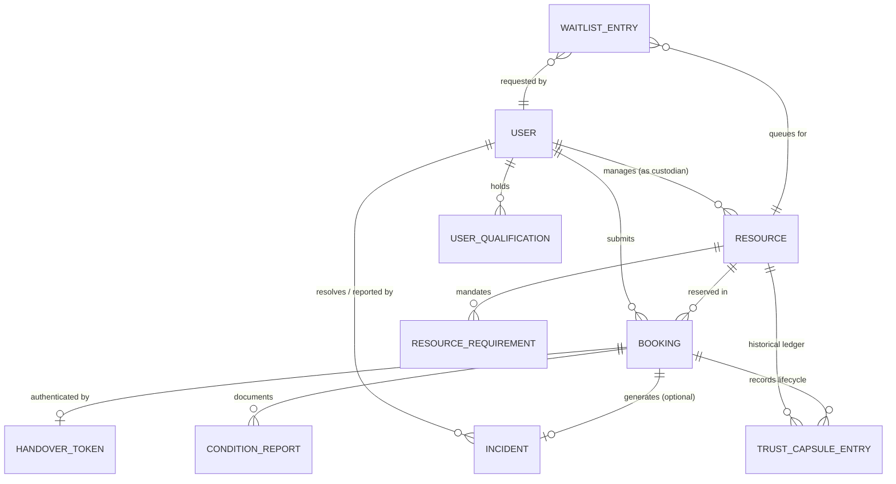

# PACT: Conceptual Data Model & Entity Specifications

> [!NOTE]
> **CONCEPTUAL DESIGN SPECIFICATION**  
> This document specifies the planned database schema, entity attributes, and relational foreign keys for PACT.  
> **No database migrations or tables have been pre-executed.** Schema creation will occur during the official hackathon sprint.

---

## 1. Entity-Relationship Overview

---

## 2. Detailed Entity Specifications

### 2.1. `users`
Represents students, faculty, custodians, and institutional administrators.
- `id`: UUID (Primary Key)
- `email`: VARCHAR(255) (Unique, Indexed)
- `full_name`: VARCHAR(255)
- `department`: VARCHAR(100)
- `role`: ENUM (`REQUESTER`, `CUSTODIAN`, `ADMINISTRATOR`, `AUDITOR`)
- `is_active`: BOOLEAN (Default: TRUE)
- `active_booking_quota`: INTEGER (Default: 2)
- `created_at`: TIMESTAMP WITH TIME ZONE

### 2.2. `user_qualifications`
Stores certified training modules or licenses held by a user.
- `id`: UUID (Primary Key)
- `user_id`: UUID (Foreign Key -> `users.id`)
- `qualification_key`: VARCHAR(100) (e.g., `LASER_SAFETY_1`, `CLEANROOM_CERT_A`)
- `issued_at`: TIMESTAMP WITH TIME ZONE
- `expires_at`: TIMESTAMP WITH TIME ZONE (Nullable)
- `is_verified`: BOOLEAN (Default: TRUE)

### 2.3. `resources`
Physical assets (equipment) or rooms (spaces) available for booking.
- `id`: UUID (Primary Key)
- `name`: VARCHAR(255)
- `category`: ENUM (`EQUIPMENT`, `SPACE`)
- `asset_tag`: VARCHAR(100) (Unique, Indexed)
- `department`: VARCHAR(100)
- `location`: VARCHAR(255) (Building, Room #)
- `custodian_id`: UUID (Foreign Key -> `users.id`)
- `status`: ENUM (`AVAILABLE`, `IN_USE`, `UNDER_MAINTENANCE`, `DECOMMISSIONED`)
- `max_duration_hours`: INTEGER (Default: 4)
- `cooldown_minutes`: INTEGER (Default: 30)
- `image_url`: VARCHAR(512) (Nullable)
- `created_at`: TIMESTAMP WITH TIME ZONE

### 2.4. `resource_requirements`
Prerequisites that a requester must possess to book a given resource.
- `id`: UUID (Primary Key)
- `resource_id`: UUID (Foreign Key -> `resources.id`)
- `qualification_key`: VARCHAR(100) (Must match `user_qualifications.qualification_key`)
- `description`: VARCHAR(255)

### 2.5. `bookings`
Core reservation record tracking state from request through custody and return.
- `id`: UUID (Primary Key)
- `resource_id`: UUID (Foreign Key -> `resources.id`, Indexed)
- `requester_id`: UUID (Foreign Key -> `users.id`, Indexed)
- `start_time`: TIMESTAMP WITH TIME ZONE
- `end_time`: TIMESTAMP WITH TIME ZONE
- `purpose`: TEXT
- `status`: ENUM (
    `DRAFT`,
    `PENDING_APPROVAL`,
    `APPROVED`,
    `REJECTED`,
    `ACTIVE_CUSTODY`,
    `RETURN_INSPECTED`,
    `COMPLETED`,
    `INCIDENT_FLAGGED`,
    `CANCELLED`,
    `NO_SHOW`
  )
- `rejection_reason`: TEXT (Nullable)
- `check_in_at`: TIMESTAMP WITH TIME ZONE (Nullable)
- `check_out_at`: TIMESTAMP WITH TIME ZONE (Nullable)
- `created_at`: TIMESTAMP WITH TIME ZONE
- `updated_at`: TIMESTAMP WITH TIME ZONE

### 2.6. `handover_tokens`
Short-lived, single-use tokens used for the dual-acknowledgement physical check-in.
- `id`: UUID (Primary Key)
- `booking_id`: UUID (Foreign Key -> `bookings.id`, Unique)
- `token_hash`: VARCHAR(255) (Secure cryptographic hash of the token)
- `expires_at`: TIMESTAMP WITH TIME ZONE (Created with 15-minute validity)
- `is_spent`: BOOLEAN (Default: FALSE)
- `spent_at`: TIMESTAMP WITH TIME ZONE (Nullable)
- `spent_by_custodian_id`: UUID (Foreign Key -> `users.id`, Nullable)

### 2.7. `condition_reports`
Photographs and physical checklists captured before and after custody.
- `id`: UUID (Primary Key)
- `booking_id`: UUID (Foreign Key -> `bookings.id`)
- `report_type`: ENUM (`PRE_USE_BASELINE`, `POST_USE_RETURN`)
- `notes`: TEXT
- `photo_evidence_url`: VARCHAR(512) (Nullable)
- `checklist_json`: JSONB (e.g., `{"lens_clean": true, "cables_intact": true, "powers_on": true}`)
- `signed_off_by_user_id`: UUID (Foreign Key -> `users.id`)
- `recorded_at`: TIMESTAMP WITH TIME ZONE

### 2.8. `incidents`
Documented damage, defects, missing components, or severe overdue returns.
- `id`: UUID (Primary Key)
- `booking_id`: UUID (Foreign Key -> `bookings.id`, Unique)
- `reported_by_id`: UUID (Foreign Key -> `users.id`)
- `incident_type`: ENUM (`PHYSICAL_DAMAGE`, `MALFUNCTION`, `LATE_RETURN`, `MISSING_PARTS`, `OTHER`)
- `description`: TEXT
- `severity`: ENUM (`LOW`, `MEDIUM`, `HIGH`, `CRITICAL`)
- `status`: ENUM (`OPEN`, `UNDER_REVIEW`, `RESOLVED_WAIVED`, `RESOLVED_PENALTY`)
- `resolution_notes`: TEXT (Nullable)
- `resolved_by_id`: UUID (Foreign Key -> `users.id`, Nullable)
- `resolved_at`: TIMESTAMP WITH TIME ZONE (Nullable)

### 2.9. `trust_capsule_entries`
Tamper-evident audit ledger chained via cryptographic SHA-256 hashes.
- `entry_id`: INTEGER (Auto-incrementing sequence)
- `resource_id`: UUID (Foreign Key -> `resources.id`, Indexed)
- `booking_id`: UUID (Foreign Key -> `bookings.id`, Nullable)
- `event_type`: VARCHAR(100) (e.g., `REQUEST_SUBMITTED`, `APPROVAL_GRANTED`, `HANDOVER_VERIFIED`, `RETURN_INSPECTED`, `INCIDENT_FLAGGED`)
- `actor_id`: UUID (Foreign Key -> `users.id`)
- `event_timestamp`: TIMESTAMP WITH TIME ZONE
- `payload_json`: JSONB (Deterministic snapshot of event data)
- `prev_hash`: VARCHAR(64) (SHA-256 hash of previous block in resource chain)
- `entry_hash`: VARCHAR(64) (SHA-256 hash of `[prev_hash + event_timestamp + event_type + actor_id + payload_json]`)

### 2.10. `waitlist_entries`
Queued requests for occupied or high-demand resource slots.
- `id`: UUID (Primary Key)
- `resource_id`: UUID (Foreign Key -> `resources.id`)
- `requester_id`: UUID (Foreign Key -> `users.id`)
- `requested_start_time`: TIMESTAMP WITH TIME ZONE
- `requested_end_time`: TIMESTAMP WITH TIME ZONE
- `queue_position`: INTEGER
- `status`: ENUM (`QUEUED`, `NOTIFIED`, `PROMOTED`, `EXPIRED`, `CANCELLED`)
- `created_at`: TIMESTAMP WITH TIME ZONE
