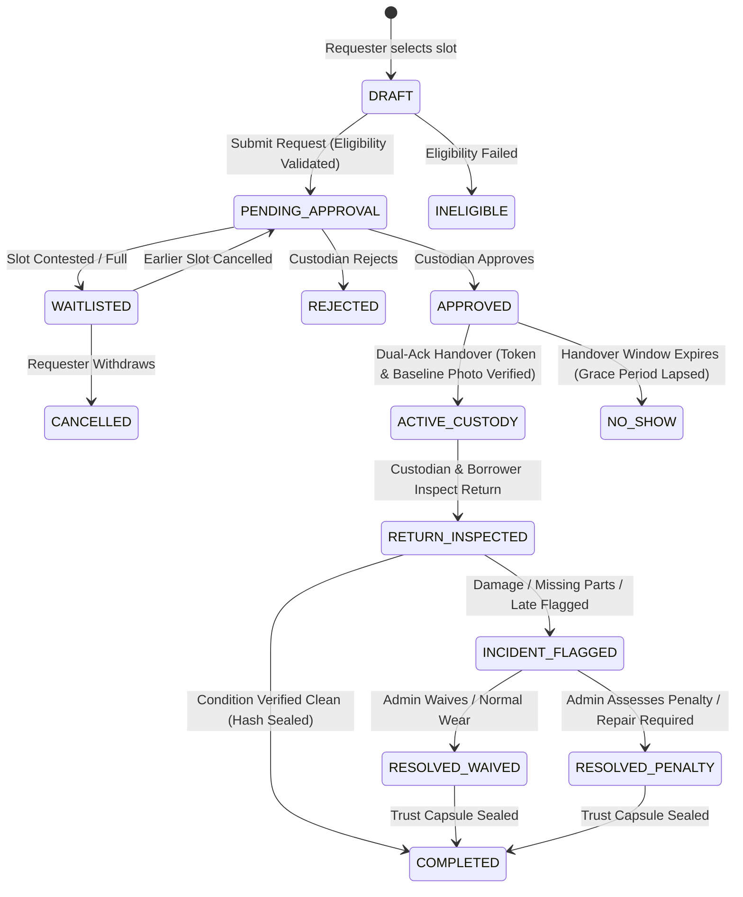

# PACT: Product Workflow & Lifecycle Specification

> [!NOTE]
> This document specifies the **intended conceptual workflow and state machine transitions** planned for the PACT platform. These workflows represent our design contract for the upcoming hackathon build window and are **not yet implemented**.

---

## 1. The Complete Ten-Step Resource Lifecycle

The PACT platform organizes resource sharing into a deterministic, auditable 10-step sequence:

```
+--------------------------------------------------------------------------------------------------+
|                                    PACT 10-STEP LIFECYCLE                                        |
+--------------------------------------------------------------------------------------------------+
|  [Step 1]  Listing & Registration   --> Custodian registers asset & sets eligibility rules      |
|  [Step 2]  Discovery & Search       --> Requester filters catalog & finds equipment/space       |
|  [Step 3]  Eligibility Verification --> System checks certifications & prerequisites             |
|  [Step 4]  Booking Request          --> Requester submits reservation slot & project rationale   |
|  [Step 5]  Approval or Waitlist     --> Custodian approves request, or requester enters queue    |
|  [Step 6]  Pre-Use Check-In         --> Dual-ack handshake & pre-condition evidence capture      |
|  [Step 7]  Active Custody & Usage   --> Requester operates asset under time-tracked custody      |
|  [Step 8]  Check-Out & Return       --> Return inspection & post-condition evidence capture      |
|  [Step 9]  Incident Resolution      --> Discrepancy flagging & administrative adjudication       |
|  [Step 10] Audit & Trust Ledger     --> Tamper-evident hash chain finalized for compliance       |
+--------------------------------------------------------------------------------------------------+
```

---

## 2. Booking State Machine & Transition Rules

Every resource booking in PACT transitions through explicit, validated states. Transitions are strictly validated server-side to prevent illegal skips.



---

## 3. Step-by-Step Operational Workflow

### Step 1: Resource Listing & Registration
- **Actor**: Resource Custodian (Lab Technician or Faculty In-Charge).
- **Action**: Fills resource registration form: Title, Category (Equipment vs. Space), Specifications, Department, Physical Location, Maximum Loan Duration, and Required Eligibility Qualifications (e.g., "Laser Safety Level 1", "ME201 Lab Training").
- **System Output**: Resource record created in catalog with status `AVAILABLE`.

### Step 2: Discovery & Search
- **Actor**: Requester (Student, Researcher).
- **Action**: Enters search query or filters catalog by category, location, and date availability.
- **System Output**: Filtered list of matching resources displaying current status, location, and eligibility criteria.

### Step 3: Eligibility Verification (Zero-Trust Gate)
- **Actor**: Requester & PACT Access Gate.
- **Action**: When a user clicks "Book Resource", the Access Gate evaluates:
  1. Does user hold required training certifications?
  2. Is user's account in good standing (no open unresolved damage penalties)?
  3. Does the user have remaining quota capacity under fair-use limits?
- **System Output**: If passes, user advances to booking form. If fails, clear explainable reason displayed (e.g., *"Requires completion of Laser Safety Module before booking"*).

### Step 4: Booking Request Submission
- **Actor**: Requester.
- **Action**: Selects start and end timestamps, inputs project description or intended research use, and clicks "Submit Request".
- **System Output**: System validates against existing approved bookings to ensure zero slot overlaps. Booking status becomes `PENDING_APPROVAL`.

### Step 5: Approval, Rejection or Waitlist Management
- **Actor**: Resource Custodian.
- **Normal Flow**: Custodian reviews pending request on dashboard and clicks "Approve". Booking transitions to `APPROVED`. Requester receives notification.
- **Alternative Flow (Rejection)**: Custodian clicks "Reject" with mandatory justification note. Booking transitions to `REJECTED`.
- **Alternative Flow (Waitlist)**: If an identical slot is already approved for another user, requester can choose "Join Waitlist". If the primary booking is cancelled, the #1 waitlist candidate is promoted to `PENDING_APPROVAL`.

### Step 6: Pre-Use Handover & Check-In (Dual-Ack Handshake)
- **Actors**: Requester & Resource Custodian (at physical lab).
- **Action**:
  1. Requester generates a short-lived Handover Token (valid for 15 minutes).
  2. Custodian enters/scans the token on their terminal.
  3. Both parties review existing condition, take baseline photo evidence, and sign off.
- **System Output**: Token is marked spent. Booking transitions to `ACTIVE_CUSTODY`. Initial Trust Capsule record logged.

### Step 7: Active Custody & Usage
- **Actor**: Requester.
- **Action**: Requester uses equipment or occupies space during the reserved window.
- **System Output**: Active custody timer visible on Requester dashboard. Automated reminder sent 30 minutes before return deadline.

### Step 8: Return Inspection & Check-Out
- **Actors**: Requester & Resource Custodian.
- **Action**:
  1. Requester brings equipment back to custodian.
  2. Custodian performs physical inspection using return checklist.
  3. Post-use photos and return condition notes are recorded.
  4. Both parties confirm return.
- **System Output**: If condition matches baseline, booking transitions to `COMPLETED`. Equipment is immediately returned to `AVAILABLE` catalog status.

### Step 9: Incident Resolution & Escalation
- **Actors**: Custodian, Requester, Department Administrator.
- **Trigger**: Custodian discovers cracked lens, burnt motor, missing accessory, or severe return delay.
- **Action**: Custodian flags booking as `INCIDENT_FLAGGED` and attaches return photos with discrepancy notes.
- **Escalation**: Administrator opens Incident Resolution Console:
  - Compares pre-use vs. post-use photographic evidence.
  - Reviews user statements and past custody history.
  - Chooses outcome: `RESOLVED_WAIVED` (wear and tear) or `RESOLVED_PENALTY` (repair fee, temporary suspension).
- **System Output**: Incident record locked; asset marked `UNDER_MAINTENANCE` or restored to `AVAILABLE`.

### Step 10: Audit History & Trust Capsule Sealing
- **Actors**: Compliance Auditor, System Ledger.
- **Action**: Complete transaction history (timestamps, actor IDs, condition hashes, approvals, incident notes) is bundled into a cryptographic Trust Capsule block and chained to the resource ledger via SHA-256 hash.
- **System Output**: Trust Replay timeline updated with verified green cryptographic seal.

---

## 4. Exception Scenarios & Failure Handling

| Scenario | System Defense / Handling |
| :--- | :--- |
| **Double-Booking Race Condition** | Relational database unique slot lock / serialized transaction guarantees that only one request can claim an overlapping window. |
| **Expired Handover Token** | Tokens expire after 15 minutes. Attempting to check-in with an expired token results in HTTP 400 Bad Request with a prompt to regenerate. |
| **Token Replay Attack** | Tokens are flagged single-use upon first successful verification. Second attempt is rejected immediately. |
| **Borrower No-Show** | If handover is not completed within 30 minutes of scheduled start, booking automatically transitions to `NO_SHOW` and slot is released to waitlist. |
| **Disputed Pre-Existing Damage** | Pre-use baseline photographs and condition sign-off stored in the Trust Capsule provide irrefutable proof of pre-existing faults. |
